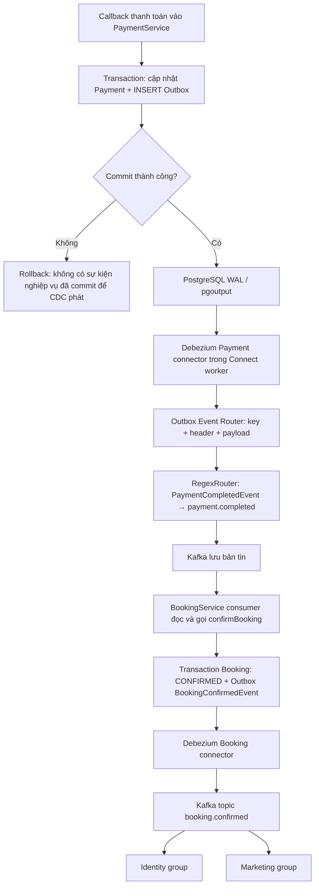

# Transactional Outbox qua Debezium CDC

Luồng: Booking/Payment lưu nghiệp vụ và Outbox trong cùng transaction PostgreSQL → WAL → PostgreSQL connector → Outbox Event Router → Kafka → consumer. Hai `OutboxRelay` và test polling đã bỏ. `@EnableScheduling` vẫn cần cho các tác vụ khác; không dùng để phát Outbox.


## Đọc luồng CDC theo thứ tự

### Hai giai đoạn có vai trò khác nhau

**Giai đoạn thiết lập:** tạo quyền DB → tạo publication → khởi động Connect worker → chạy script đăng ký hai connector. Script Python chỉ điều khiển cấu hình qua REST; nó không đọc WAL, không chạy cho từng booking và không phải Service Java.

**Giai đoạn xử lý nghiệp vụ:** Service ghi database → connector đang chạy đọc thay đổi từ WAL → các biến đổi chạy bên trong Connect → producer Connect gửi Kafka → consumer Spring xử lý. Đóng terminal đăng ký không dừng connector: worker tiếp tục chạy bằng cấu hình được Kafka Connect lưu.



Sơ đồ mô tả đường đi theo mã và cấu hình, không phải minh chứng toàn bộ luồng đã chạy. Callback hợp lệ thực tế còn có kiểm tra chữ ký và trạng thái. CDC không làm mất ranh giới transaction: Payment và Booking vẫn có hai transaction database riêng.

### Một sự kiện thanh toán đi qua từng bước

1. `VnpayPayment.callback()` xác thực callback. Nhánh thành công cập nhật Payment, tạo `PaymentCompletedEvent` và lưu `OutboxEvent` trong transaction. Nếu transaction rollback, bản ghi Outbox không được commit.
2. Trong Outbox Payment, `aggregate_id = payment.getId().toString()`, `event_type = PaymentCompletedEvent`, `payload` chứa JSON với cả `paymentId` và `bookingId`. Trong Outbox Booking, `aggregate_id` lại lấy ID booking. Đây là giá trị thật trong Java, không phải connector tự sinh bookingId.
3. PostgreSQL có `wal_level=logical`. `pgoutput` cung cấp thay đổi qua publication. Publication giới hạn bảng; replication slot theo dõi tiến độ logical decoding và giữ WAL cần thiết trong điều kiện vận hành cho phép. LSN là vị trí trong WAL, không phải Kafka offset.
4. Task Debezium kết nối PostgreSQL bằng tài khoản CDC, dùng publication/slot tương ứng. Ban đầu có thể đọc snapshot bằng SELECT; sau snapshot tiếp tục WAL. Vì vậy CDC ở đây vẫn có SELECT khi snapshot, nhưng không lặp truy vấn pending Outbox theo scheduler.
5. Bản ghi CDC đầu vào có metadata và dữ liệu row. Topic trước biến đổi của Payment là `cinematrix_payment.public.outbox_payment_events`; predicate `isOutbox` nhận diện tên này.
6. EventRouter lấy key từ `aggregate_id`, value từ `payload`, event ID từ `id`. Nó thêm header `__TypeId__` và `outbox-event-id`. Route theo `event_type` tạo tên topic tạm `PaymentCompletedEvent`.
7. Các RegexRouter chạy theo thứ tự. Hai rule Booking không khớp thì đi qua; rule PaymentCompleted đổi tên thành `payment.completed`. Rule PaymentFailed không khớp với tên vừa đổi, nên không đổi tiếp.
8. Các converter ghi key string, value JSON và headers thành bytes. Producer của Connect gửi bản tin tới Kafka. Cấu hình `spring.kafka.producer` trong Service Java không cấu hình producer Connect này.
9. Consumer Booking đọc `payment.completed`. Type mapping dùng `__TypeId__=PaymentCompletedEvent` để chọn DTO. Listener gọi `confirmBooking()`; Service lấy `bookingId` trong payload để tìm booking, không lấy Kafka key làm bookingId.
10. Booking lưu trạng thái xác nhận và một Outbox `BookingConfirmedEvent`. Connector Booking phát sự kiện này sang `booking.confirmed`; Identity và Marketing dùng group riêng để cùng nhận. Tác động của từng consumer vẫn cần chống lặp bền vững.

Đối chiếu Java: `paymentservice/src/main/java/com/cgv/paymentservice/service/impl/VnpayPayment.java` (callback và tạo Outbox); `bookingservice/src/main/java/com/cgv/bookingservice/consumer/PaymentEventConsumer.java` (listener); `bookingservice/src/main/java/com/cgv/bookingservice/service/impl/BookingServiceImpl.java` (confirmBooking và tạo Outbox).

### Ví dụ dữ liệu để đọc cấu hình

Ví dụ dưới là dữ liệu minh họa, không phải output hoặc booking đang tồn tại:

| Khái niệm | Giá trị minh họa |
|---|---|
| Booking ID trong payload | `11111111-1111-1111-1111-111111111111` |
| Payment ID, cũng là aggregate_id của Outbox Payment | `22222222-2222-2222-2222-222222222222` |
| Outbox event ID | `33333333-3333-3333-3333-333333333333` |
| event_type | `PaymentCompletedEvent` |

Sau biến đổi, topic là `payment.completed`; key là Payment ID; header `outbox-event-id` là Outbox event ID. Payload vẫn có Booking ID để BookingService tìm đúng đơn. Ba ID có ba vai trò riêng; Kafka không tự suy ra chúng thay cho Service.

### Publication, slot và offset

| Thành phần | Lưu ở đâu | Giúp giải quyết việc gì |
|---|---|---|
| Publication | PostgreSQL | Chọn bảng được công bố qua pgoutput. Không tự gửi dữ liệu sang Kafka. |
| Replication slot | PostgreSQL | Theo dõi luồng logical decoding và WAL cần giữ cho client. Không phải bảng processed-event. |
| Source offset của connector | Offset storage topic của Kafka Connect | Lưu tiến độ nguồn, gồm vị trí WAL phù hợp để connector tiếp tục khi phục hồi. |
| Consumer offset | Kafka, theo consumer group/topic/partition | Cho biết consumer nghiệp vụ đã xác nhận đọc tới vị trí nào. Độc lập với source offset. |
| Outbox event ID | Row Outbox và Kafka header | Định danh sự kiện để đối chiếu hoặc xây dựng dedup nghiệp vụ. |

Khi Connect dừng, các transaction Service vẫn có thể lưu Outbox nếu DB hoạt động. Sau khi phục hồi, connector dùng slot/offset để tiếp tục, với điều kiện WAL/slot/offset cần thiết còn hợp lệ. Dừng quá lâu có thể làm WAL giữ lại tăng; sự kiện cũng có thể phát lại sau sự cố. `is_published=false` không theo dõi tiến độ CDC sau snapshot.

### Vai trò và chú thích của năm file

| File | Ai đọc/chạy | Khi nào dùng | Có chạy cho từng booking không? |
|---|---|---|---|
| `debezium/booking-outbox.json` | Script đọc template; Connect nhận config sau render | Đăng ký/cập nhật connector Booking | Không; task dùng cấu hình liên tục |
| `debezium/payment-outbox.json` | Script đọc template; Connect nhận config sau render | Đăng ký/cập nhật connector Payment | Không; task dùng cấu hình liên tục |
| `scripts/register-outbox-cdc.py` | Người vận hành chạy Python | Đăng ký, kiểm tra config hoặc xem status | Không |
| `debezium/prepare-local-role.sql` | Người vận hành chạy bằng psql | Chuẩn bị quyền DB local | Không |
| `debezium/publications.sql` | Owner/DBA chạy bằng psql | Chuẩn bị publication khi bảng đã tồn tại | Không |

JSON chuẩn không nhận comment. Bản đọc có chú thích từng thuộc tính nằm tại [Booking annotated JSONC](../debezium/booking-outbox.annotated.jsonc) và [Payment annotated JSONC](../debezium/payment-outbox.annotated.jsonc). Script đăng ký vẫn chỉ đọc `.json`; không gửi `.jsonc` lên Connect. Python và hai SQL có chú thích ngay trước từng dòng lệnh; phần thực thi giữ nguyên.

Trong JSONC, `${CDC_DB_HOST}` và các biến `CDC_*` được Python thay khi đăng ký. Riêng `${routedByValue}` phải giữ nguyên để Debezium dùng lúc xử lý sự kiện. Regex `public\.outbox_payment_events` khớp một dấu chấm thật; trong JSON cần viết `public\\.outbox_payment_events` vì backslash phải escape.

`--check` không kết nối DB/Kafka; REST validate cũng không thay thế phép thử có bản tin thật. Task RUNNING mới xác nhận trạng thái hoạt động của task tại lúc kiểm tra. Script đợi tối đa theo hạn 90 giây và kiểm tra mỗi 2 giây; các con số này không phải độ trễ gửi một sự kiện.

### Thứ tự chuẩn bị và đăng ký

1. Có hai bảng Outbox và logical replication được bật trên PostgreSQL.
2. Tạo tài khoản CDC đúng môi trường; cấp quyền đọc bảng và replication.
3. Chạy `publications.sql`, kiểm tra output đúng publication/schema/bảng. Publication đã tồn tại sẽ không tự được sửa danh sách bảng bởi file này.
4. Khởi động worker Connect, cung cấp Kafka bootstrap/storage topics; RDS cần CA mount và TLS phù hợp.
5. Chạy script để render và đăng ký hai connector; kiểm tra connector cùng task.
6. Tạo một nghiệp vụ mới và đối chiếu row Outbox → event Kafka → tác động consumer. Không xóa slot/offset để làm một bài test “sạch” trên dữ liệu đang dùng.

Tham khảo cơ chế: [PostgreSQL logical decoding](https://www.postgresql.org/docs/15/logicaldecoding-explanation.html), [Debezium PostgreSQL connector](https://debezium.io/documentation/reference/2.7/connectors/postgresql.html), [Outbox Event Router](https://debezium.io/documentation/reference/2.7/transformations/outbox-event-router.html), [Kafka Connect user guide](https://kafka.apache.org/36/kafka-connect/user-guide/). Worker hiện giữ image 2.5 trong Compose; đây không phải kết quả kiểm chứng runtime của version 2.7.

## Hợp đồng bản tin và cấu hình

Hai connector riêng cho hai bảng cùng database `cgv`, schema `public`. Mỗi connector có slot, publication và topic prefix riêng. Nếu database/schema triển khai khác, sửa template tương ứng trước khi đăng ký.

| Cột Outbox | Bản tin Kafka |
|---|---|
| `aggregate_id` | Key dạng string: Booking dùng bookingId; Payment hiện dùng paymentId. Cùng key vào cùng partition khi partitioner và số partition ổn định |
| `payload` (TEXT chứa JSON) | JSON object trực tiếp nhờ `table.expand.json.payload=true`; không có envelope/schema của Connect |
| `event_type` | Header `__TypeId__`, ánh xạ trong Spring deserializer |
| `id` | Header `id` mặc định và `outbox-event-id` để định danh sự kiện |

RegexRouter chuyển `BookingCreatedEvent` → `booking.created`, `BookingConfirmedEvent` → `booking.confirmed`, `PaymentCompletedEvent` → `payment.completed`, `PaymentFailedEvent` → `payment.failed`. Thêm loại sự kiện phải bổ sung route và consumer contract tương ứng.

Deployment EKS đặt group riêng cho Identity (`identity-service-group`) và Marketing (`marketing-service-group`), ghi đè group dùng chung trong ConfigMap. Hai dịch vụ cần nhận độc lập sự kiện `booking.confirmed`; các replica trong cùng dịch vụ mới chia partition với nhau.

`StringConverter` cho key tránh key có dấu ngoặc kép JSON; `SimpleHeaderConverter` giữ header dạng UTF-8; `JsonConverter` với schemas false ghi payload JSON. Booking/Marketing custom factory và Identity profile có type mapping; header FQCN của producer Spring cũ vẫn được hỗ trợ.

`is_published`, `retry_count`, `next_attempt_at` được giữ để tương thích schema. CDC **không cập nhật** các cột này; `is_published=false` không có nghĩa CDC chưa gửi. Offset trong Kafka Connect và LSN/slot PostgreSQL xác định tiến độ. Outbox mới chỉ INSERT; không UPDATE để đánh dấu đã phát. EventRouter đặt invalid UPDATE là fatal.

## Chuyển từ polling

1. Chọn thời điểm dừng ghi mới Booking/Payment; dừng mọi instance cũ có relay, kể cả Pod/image cũ. Rebuild/redeploy Booking, Payment và các consumer có type mapping.
2. Kiểm tra hai bảng và danh sách `event_type`, payload JSON, số dòng cũ đã gửi/chưa gửi. Template initial snapshot chỉ lấy `is_published IS DISTINCT FROM TRUE`; sau đó stream INSERT mới từ WAL. Đã gửi qua polling nhưng crash trước published có thể xuất hiện lại. Không đăng ký connector thứ hai cùng bảng vào cùng topic.
3. Chuẩn bị quyền/publication; tạo connector và kiểm tra connector **và task** RUNNING. Cho phép ghi nghiệp vụ trở lại sau khi consumer contract và luồng CDC được kiểm tra.
4. Giữ tên connector/slot/prefix và storage topics ổn định. Không xóa offset/slot hoặc đổi `snapshot.mode=always` để “retry”: có thể phát lại lịch sử. `initial` chỉ snapshot khi chưa có offset.

CDC có ngữ nghĩa at-least-once. Consumer cần dedup bền vững trong transaction nghiệp vụ. Booking đã kiểm tra trạng thái dưới khóa ghi; UserSpendConsumer hiện chưa có processed-event ledger và Marketing chưa có minh chứng xử lý lặp đồng thời đầy đủ. Chỉ kiểm tra có event trong Kafka chưa chứng minh exactly-once cho chi tiêu/voucher.

## Cổng Docker và biến môi trường của worker

`127.0.0.1:8088:8083` có dạng IP host : cổng host : cổng container. Trên máy Mac, gọi `http://127.0.0.1:8088`; Docker chuyển request vào REST Connect cổng 8083 trong container. Container cùng mạng gọi `http://debezium-connect:8083`. Cổng này phục vụ đăng ký/xem connector; worker gửi dữ liệu Kafka qua các địa chỉ `BOOTSTRAP_SERVERS`.

Docker truyền `environment` vào tiến trình container. Entry point của image Debezium 2.5 đổi các alias hỗ trợ sẵn (`BOOTSTRAP_SERVERS`, `GROUP_ID`, tên storage topic, converter) sang biến `CONNECT_*`; sau đó đổi tên `CONNECT_*` thành chữ thường, bỏ tiền tố và đổi `_` thành `.` để ghi vào file worker `connect-distributed.properties`. Đây là cấu hình worker trong container, không tự ghi vào POM, application.yml hay hai template JSON.

| Biến environment đúng | Property worker | Ý nghĩa |
|---|---|---|
| `BOOTSTRAP_SERVERS` | `bootstrap.servers` | Địa chỉ broker để tìm Kafka cluster |
| `GROUP_ID` | `group.id` | Nhóm worker Connect, độc lập group consumer nghiệp vụ |
| `CONFIG_STORAGE_TOPIC` | `config.storage.topic` | Kafka topic lưu cấu hình connector |
| `OFFSET_STORAGE_TOPIC` | `offset.storage.topic` | Kafka topic lưu source offset của connector |
| `STATUS_STORAGE_TOPIC` | `status.storage.topic` | Kafka topic lưu trạng thái connector/task |
| `CONNECT_CONFIG_STORAGE_REPLICATION_FACTOR` | `config.storage.replication.factor` | Số bản sao khi Connect tạo config storage topic |
| `CONNECT_OFFSET_STORAGE_REPLICATION_FACTOR` | `offset.storage.replication.factor` | Số bản sao khi tạo offset storage topic |
| `CONNECT_STATUS_STORAGE_REPLICATION_FACTOR` | `status.storage.replication.factor` | Số bản sao khi tạo status storage topic |
| `KEY_CONVERTER` | `key.converter` | Converter mặc định của key |
| `VALUE_CONVERTER` | `value.converter` | Converter mặc định của value |
| `CONNECT_VALUE_CONVERTER_SCHEMAS_ENABLE` | `value.converter.schemas.enable` | Tắt envelope schema/payload của JsonConverter |

Các tên replication và schemas trong bản Compose trước thiếu tiền tố `CONNECT_`; entrypoint 2.5 không có alias cho chúng. Đã sửa dev/prod và manifest worker EKS. Bỏ dòng `KEY_CONVERTER_SCHEMAS_ENABLE` vì key đang dùng StringConverter, không dùng tùy chọn này. Replication factor chỉ điều khiển lúc tạo topic mới, không tự đổi số replica của topic đã tồn tại. Worker readiness cũng không thay cho trạng thái task. Storage topics phải có `cleanup.policy=compact`; config topic bắt buộc đúng một partition. Compose dev dùng `cinematrix_connect_configs` một partition và giữ hai topic offset/status hiện có. `scripts/init-kafka-topics.sh` chuẩn bị những cấu hình này; biến CONNECT_CONFIG_TOPIC/CONNECT_OFFSET_TOPIC/CONNECT_STATUS_TOPIC cho phép chọn tên khác khi đối chiếu môi trường.

Nguồn ánh xạ: [entrypoint chính thức của Debezium 2.5](https://github.com/debezium/container-images/blob/main/connect-base/2.5/docker-entrypoint.sh), [Kafka Connect worker configs](https://kafka.apache.org/36/configuration/kafka-connect-configs/), [Docker port publishing](https://docs.docker.com/engine/network/port-publishing/).

## Chạy Compose dev

Chạy từ BE root. Docker Desktop phải chạy. Không xóa volume PostgreSQL/Kafka để sửa cấu hình. Giữ image Debezium 2.5 đang có; phiên bản Kafka `latest` phải ghi nhận ở lần thực nghiệm, đã kiểm chứng worker/task và một sự kiện streaming local; thanh toán VNPay trọn luồng vẫn cần kiểm thử riêng.

```bash
docker compose -f docker-compose-dev.yml up -d postgres kafka-1 kafka-2 kafka-3 debezium-connect
curl --fail http://127.0.0.1:8088/connector-plugins
```

Nếu worker chưa sẵn sàng, xem `docker compose -f docker-compose-dev.yml logs debezium-connect`. REST host 8088 được sửa sang container 8083. Khởi động/migrate Booking và Payment theo schema đang dùng để hai bảng Outbox tồn tại trước bước SQL. Flyway hiện bật trong dev/prod với lịch sử riêng từng service và Hibernate validate; kiểm tra migration log trước bước SQL. Xem docs/FLYWAY_LOCAL.md cho database cũ.

```bash
docker exec cgv-postgres psql -U postgres -d cgv -c 'SHOW wal_level;'
docker exec cgv-postgres psql -U postgres -d cgv -c "SELECT to_regclass('public.outbox_booking_events'), to_regclass('public.outbox_payment_events');"
docker exec -i -e CDC_DB_PASSWORD=cdc-local-only cgv-postgres \
  psql -U postgres -d cgv < debezium/prepare-local-role.sql
docker exec -i cgv-postgres psql -U postgres -d cgv < debezium/publications.sql
python3 scripts/register-outbox-cdc.py --local --check
python3 scripts/register-outbox-cdc.py --local
python3 scripts/register-outbox-cdc.py --status
```

`cdc-local-only` là mật khẩu dành riêng demo local. Script đăng ký kiểm tra config qua REST validate rồi PUT config, chờ task RUNNING; không in password/config đầy đủ. PUT cùng tên cập nhật connector, không tạo bản sao tên mới.

## Chạy trên EKS/RDS

Đây là cấu hình và hướng dẫn, chưa apply cloud trong lần sửa. Connect cần CPU/RAM và có thể phát sinh chi phí; không mặc định thuộc Free Tier.

1. RDS custom parameter group: bật `rds.logical_replication=1`, áp dụng và reboot theo lịch vận hành; kiểm tra `wal_level`, `max_replication_slots`, `max_wal_senders` đủ cho hai slot và các client khác. Dùng endpoint PostgreSQL writer trực tiếp, kiểm tra connectivity/Security Group từ Pod. Không dùng endpoint RDS Proxy cho replication trong cấu hình này.
2. DBA tạo user CDC riêng với mật khẩu bí mật; cấp `rds_replication`, CONNECT database, USAGE schema, SELECT hai Outbox. Publication do owner/DBA tạo bằng `debezium/publications.sql`; connector đặt `publication.autocreate.mode=disabled`, không tự tạo publication toàn database. Không chạy SQL `prepare-local-role.sql` trên RDS.
3. Tải AWS RDS CA bundle, tạo ConfigMap CA trước khi deploy worker. Manifest đã mount bundle vào `/etc/cdc/rds-ca.pem`. Template nhận đường dẫn qua `CDC_DB_SSLROOTCERT`; giữ `database.sslmode=verify-full`. Đường dẫn là trong container.
4. Apply worker/ClusterIP sau khi review tài nguyên và Kafka topology:

```bash
curl --fail --output /tmp/global-bundle.pem \
  https://truststore.pki.rds.amazonaws.com/global/global-bundle.pem
kubectl -n cgv-prod create configmap debezium-rds-ca \
  --from-file=global-bundle.pem=/tmp/global-bundle.pem \
  --dry-run=client -o yaml | kubectl apply -f -
kubectl apply -f k8s/debezium/connect.yml
kubectl -n cgv-prod rollout status deployment/debezium-connect
kubectl -n cgv-prod port-forward service/debezium-connect 8088:8083
```

Ở terminal thứ hai, nhập các biến mà **worker** dùng để kết nối DB:

```bash
export CDC_DB_HOST='<RDS writer endpoint>'
export CDC_DB_USER='cdc_user'
export CDC_DB_NAME='cgv'
export CDC_DB_SSLMODE='verify-full'
export CDC_DB_SSLROOTCERT='/etc/cdc/rds-ca.pem'
read -s 'CDC_DB_PASSWORD?CDC database password: '
export CDC_DB_PASSWORD
python3 scripts/register-outbox-cdc.py --check
python3 scripts/register-outbox-cdc.py
unset CDC_DB_PASSWORD
```

Lệnh `read` trên dành cho zsh/macOS. REST Connect chứa cấu hình nhạy cảm; giữ ClusterIP/port-forward, không mở công khai. Script render template trong bộ nhớ. Mount CA hoàn chỉnh trước đăng ký; không hạ TLS để vượt lỗi chứng chỉ.

## Test và ảnh minh chứng

Test contract local, không broker:

```bash
mvn -pl bookingservice,paymentservice,marketingservice -am \
  -Dtest=CdcEventDeserializationTest,BookingIntegrityIntegrationTest,PaymentCallbackIntegrationTest \
  -Dsurefire.failIfNoSpecifiedTests=false test
```

Chụp các test pass: bản tin có header short type đọc đúng DTO, UUID, amount, Instant; thiếu header bị từ chối; header producer cũ còn đọc được. JPA/H2 test kiểm tra rollback và idempotency nghiệp vụ; không thay minh chứng WAL/SMT/broker.

Lần chạy chọn lọc tại local có 11 ca đạt (Booking 8, Payment 2, Marketing 1). Log được lưu tại `target/cdc-verification.log`. Nếu JVM trong môi trường hạn chế không cho Mockito self-attach, cấu hình Mockito Java agent theo đường dẫn jar trên máy; không coi lỗi attach là lỗi logic CDC. Không dùng thời gian suite làm độ trễ API/CDC.

Để chụp CDC thật:

```bash
python3 scripts/register-outbox-cdc.py --status
docker exec cgv-postgres psql -U postgres -d cgv -c \
  "SELECT slot_name, plugin, active, confirmed_flush_lsn FROM pg_replication_slots WHERE slot_name LIKE 'cinematrix_%';"
docker exec cgv-kafka-1 /opt/kafka/bin/kafka-console-consumer.sh \
  --bootstrap-server cgv-kafka-1:19092 --topic payment.completed \
  --property print.key=true --property print.headers=true
```

Mở console **trước** khi thanh toán booking sandbox mới qua FE. Chụp event có bookingId tương ứng trong payload, key bằng paymentId (aggregate_id của Outbox Payment), header `__TypeId__=PaymentCompletedEvent`, outbox-event-id và JSON object; đối chiếu dòng DB bằng id và booking/status. Chụp thêm consumer Booking xác nhận đúng booking. Không dùng `--from-beginning` trên dữ liệu cũ để suy ra event mới đã được CDC phát.

Thử phục hồi local: dừng Connect, thực hiện một nghiệp vụ tạo Outbox mới, xác nhận row đã commit; khởi động lại Connect và kiểm tra event với đúng id xuất hiện. Thử rollback qua service phải không tạo row/event. Thực nghiệm này cần dữ liệu demo và chụp output thật; chưa có kết quả ở lần sửa này. Không kết luận “không mất event” chỉ từ RUNNING; theo dõi slot/WAL, offset lag và lỗi task. Chưa đo độ trễ CDC, RPS hay Kafka rebalance.

Nguồn: [Debezium Outbox Event Router](https://debezium.io/documentation/reference/stable/transformations/outbox-event-router.html), [PostgreSQL Connector](https://debezium.io/documentation/reference/stable/connectors/postgresql.html), [AWS RDS logical replication](https://docs.aws.amazon.com/AmazonRDS/latest/UserGuide/PostgreSQL.Concepts.General.FeatureSupport.LogicalReplication.html), [Kafka Connect transforms](https://kafka.apache.org/36/kafka-connect/user-guide/).
